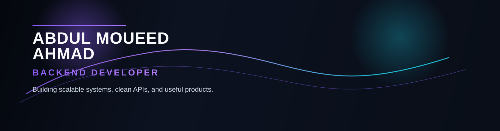

  

<h1 align="center">Abdul Moueed Ahmad</h1>
<h3 align="center">Backend Developer</h3>

  
  
  

  I build reliable backend systems, secure APIs, and maintainable services focused on practical product logic, clean architecture, and long-term stability.

## About Me

I’m a backend-focused developer interested in building dependable service layers, API-driven systems, and data-heavy applications that are easy to understand and scale. My work centers on server-side logic, database design, authentication, and product-facing features that connect business requirements to real user value.

I care about clean architecture, maintainable code, and systems that can evolve without becoming fragile. Whether it’s a Spring Boot service, a MongoDB-backed workflow, or a secure REST API, I focus on reliability, structure, and practical engineering decisions.

## Technical Skills

### Languages

### Backend & Data

### Frontend & Tools

## Featured Projects

### [clinic-management-system](https://github.com/abdul15x/clinic-management-system)
A clinic management backend built with Spring Boot and MongoDB to handle patient, appointment, and medical record workflows with secure authentication and service-driven logic.

- Java + Spring Boot
- MongoDB data storage
- JWT-based security and authorization
- MVC and REST API structure
- Appointment and patient management flows

### [Pitchbolt](https://github.com/abdul15x/Pitchbolt)
A Next.js product for generating startup pitch materials, structured documents, and presentation-ready output with AI-assisted workflows.

- Next.js and React
- TypeScript-based app structure
- OpenAI integration for content generation
- PDF and PowerPoint export features
- UI built for fast idea-to-pitch processing

### [BankSol](https://github.com/abdul15x/BankSol)
A blockchain banking prototype built with React and ethers.js for wallet connection, balance checks, and ETH transfer/deposit flows.

- Vite + React frontend
- MetaMask wallet integration
- Ethereum smart contract interaction
- Deposit and withdrawal workflows
- Sepolia testnet-focused transaction flow

## What I'm Working On

- Strengthening backend architecture and API design patterns
- Improving secure authentication and maintainable service layers
- Building practical, deployment-oriented applications with real product logic
- Exploring backend system design, data modeling, and scalable application workflows

## GitHub Statistics

  

  

## Professional Contact

- LinkedIn: [abdul15x](https://www.linkedin.com/in/abdul15/)
- GitHub: [abdul15x](https://github.com/abdul15x)
- Email: [abdulmoueedahmad@gmail.com](mailto:abdulmoueedahmad@gmail.com)

## Footer

Reliable systems. Clean code. Continuous learning.
